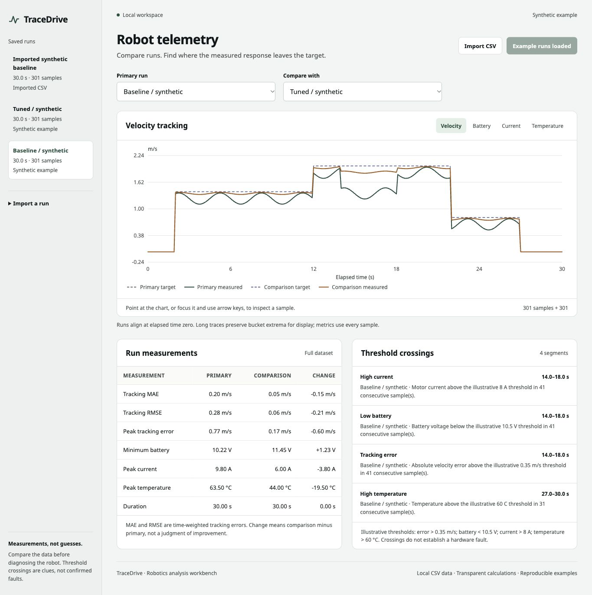
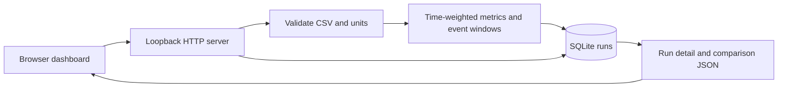

# TraceDrive

A local robotics telemetry workbench: import a CSV, inspect velocity tracking and sensor excursions, and compare two test runs without hiding the math behind a single score.

**Python 3.11+ · SQLite · standard library only · local browser dashboard**

The included Baseline and Tuned runs are **deterministic synthetic examples**, not recorded robot measurements. Thresholds are illustrative. TraceDrive does not diagnose hardware faults or establish that a real controller improved.



## Run it

From the repository directory:

```sh
python3 -m tracedrive.server --port 8012
```

Open [http://127.0.0.1:8012](http://127.0.0.1:8012). Load the synthetic demo from the dashboard, or import a CSV using the schema below. No account, API key, package installation, or external service is needed.

The default database is `data/tracedrive.sqlite3`, excluded from Git. Runs remain after the server restarts. To use a separate local dataset, choose a different database file:

```sh
python3 -m tracedrive.server --port 8012 --db data/practice.sqlite3
```

Demo seeding adds the two example runs **only when the database is empty**. It never overwrites an imported run. The application has no delete or reset endpoint.

## Try three useful experiments

1. Load the synthetic Baseline and Tuned runs. Compare tracking MAE and minimum battery voltage. The tuned example is designed to have smaller tracking error; this is an illustration, not experimental evidence.
2. Import `samples/baseline-synthetic.csv` under a new name. Change a timestamp to duplicate the preceding one, then try importing again. The whole run should be rejected with a row-specific message.
3. Compare two genuine runs recorded with the same task, units, sensor calibration, and comparable sampling. Use excursions to decide what to investigate; the app cannot tell you their cause.

## What the project demonstrates

- **Strict ingestion:** finite numeric values, named units, ordered timestamps, bounded uploads, and clear row-level validation errors.
- **Time-weighted analysis:** trapezoidal MAE and RMSE account for uneven sampling intervals.
- **Inspectable anomaly windows:** consecutive above/below-threshold samples form events with a start, end, extreme value, and explanation.
- **Durable comparisons:** validated samples and derived results are stored together in SQLite; metric deltas always mean right run minus left run.
- **Separation of concerns:** CSV parsing and analysis are pure functions, persistence is a separate module, and HTTP is a thin adapter.

## CSV format

```csv
time_s,target_velocity_mps,velocity_mps,battery_v,motor_current_a,temperature_c
0.0,1.0,0.8,12.3,2.5,28.0
0.2,1.0,0.9,12.2,2.7,28.2
0.6,1.0,1.0,12.2,2.6,28.3
```

All six headers are required exactly once, in any order. Extra columns are rejected so accidental unit/schema changes are visible. A UTF-8 BOM is accepted.

| Field | Meaning | Accepted range |
| --- | --- | --- |
| `time_s` | Timestamp in seconds | 0–86,400; strictly increasing |
| `target_velocity_mps` | Requested linear speed | −50 to 50 m/s |
| `velocity_mps` | Measured linear speed | −50 to 50 m/s |
| `battery_v` | Measured voltage | 0–100 V |
| `motor_current_a` | Measured current, signed | −200 to 200 A |
| `temperature_c` | Measured temperature | −50 to 200 °C |

These broad ingestion bounds catch malformed values; they are **not safe operating limits**. At least two samples are required, up to 20,000 samples. The CSV and HTTP request each have a 2 MiB limit; JSON escaping can make the request slightly larger than the CSV. Run names are limited to 80 characters. NaN, infinity, blank numbers, duplicate timestamps, out-of-order rows, and malformed row widths are rejected.

### Analysis definitions

For sample `i`, let `e_i = measured_velocity_i - target_velocity_i`, `dt_i = t_i - t_(i-1)`, and `T = t_last - t_first`.

```text
MAE  = sum(dt_i * (abs(e_(i-1)) + abs(e_i)) / 2) / T
RMSE = sqrt(sum(dt_i * (e_(i-1)^2 + e_i^2) / 2) / T)
```

These are trapezoidal approximations of the **sampled absolute and squared errors**, not exact integration of an unknown continuous signal. Values are rounded to six decimal places for the API. Peak error is the largest observed absolute velocity error; sensor extrema are observed sample values.

| Event kind | Illustrative condition |
| --- | --- |
| `tracking_error` | Absolute velocity error > 0.35 m/s |
| `low_battery` | Battery voltage < 10.5 V |
| `high_current` | Signed motor current > 8 A |
| `high_temperature` | Temperature > 60 °C |

Thresholds are strict: equality does not trigger a sensor event. Events group consecutive offending samples; their bounds are the first and last such timestamps. A single sample has `start_s == end_s`. The app does not interpolate threshold crossings or infer what happened during a sampling gap. For low battery, `peak_value` is the **minimum** voltage; for the other event types it is the maximum observed value.

## Architecture



```text
tracedrive/
  analysis.py  CSV validation, metrics, threshold windows
  demo.py      Reproducible synthetic data generator
  store.py     Atomic SQLite persistence and comparisons
  server.py    Local HTTP adapter and static-file serving
tests/         Analysis, persistence, concurrency, and HTTP tests
samples/       Labeled synthetic CSVs for importing
web/           Browser dashboard
```

See [engineering decisions](docs/engineering-decisions.md) for the tradeoffs and [walkthrough exercises](docs/walkthrough.md) for ways to make the project your own.

## API

| Method | Route | Result |
| --- | --- | --- |
| GET | `/api/state` | Run metadata and current thresholds |
| GET | `/api/runs/{id}` | Metadata, full samples, and anomaly windows |
| POST | `/api/runs` | Validate and save `{ "name": "…", "csv": "…" }` |
| GET | `/api/compare?left={id}&right={id}` | Both run summaries and right-minus-left deltas |
| GET | `/api/sample.csv` | Generated synthetic Baseline CSV |
| POST | `/api/demo/seed` | Seed examples only into an empty database |

Examples:

```sh
curl http://127.0.0.1:8012/api/state
curl -X POST http://127.0.0.1:8012/api/demo/seed \
  -H 'Content-Type: application/json' -d '{}'
```

To import the checked-in example without manually escaping newlines:

```sh
python3 - <<'PY'
import json
from pathlib import Path
from urllib.request import Request, urlopen
payload = {"name": "Imported synthetic baseline", "csv": Path("samples/baseline-synthetic.csv").read_text()}
request = Request("http://127.0.0.1:8012/api/runs", data=json.dumps(payload).encode(),
                  headers={"Content-Type": "application/json"}, method="POST")
with urlopen(request) as response:
    print(response.read().decode())
PY
```

Errors have `{ "error": "code", "message": "Readable explanation" }`. Validation errors return 400, missing runs 404, unsupported media types 415, and oversized requests 413. Comparisons never require equal sampling frequencies because each run's metrics are computed independently. They do require a scientifically fair comparison chosen by the person interpreting the results.

The dashboard aligns overlaid traces to **elapsed time**: each run's first timestamp becomes zero. This is a display alignment, not signal resampling or automatic synchronization of robot actions. Analysis uses every validated sample in each original run.

## Tests

```sh
python3 -m unittest discover -s tests -v
```

The test suite checks uneven sampling against hand-calculated results, sensor thresholds and event grouping, CSV limits and invalid values, durable storage, concurrent demo seeding, non-destructive behavior, delta direction, and actual HTTP request/response behavior. CI runs the same command on Python 3.11, 3.12, and 3.13.

## Scope and limitations

- Local, single-user analysis tool. The HTTP server binds to `127.0.0.1`, checks local hosts/origins, and has no authentication. It is not a production or internet-facing service.
- No direct VEX connection, live telemetry streaming, controller tuning, or hardware validation is included.
- Current uses signed readings; a large negative regenerative current does not trigger the positive-current threshold.
- No automatic resampling, calibration correction, unit conversion, gap estimation, or causal diagnosis.
- Dataset count is not capped, and full runs are returned as JSON. The per-run cap keeps this first version suitable for short local experiments, not fleet-scale collection.
- Generated examples intentionally show different behavior. There is no claimed performance improvement on a real robot.

## Development note

The initial implementation was created with AI assistance. The tests, formulas, design decisions, and known limitations are available for inspection. The sample data are generated by `tracedrive/demo.py`; no private team logs or internship material are included.
